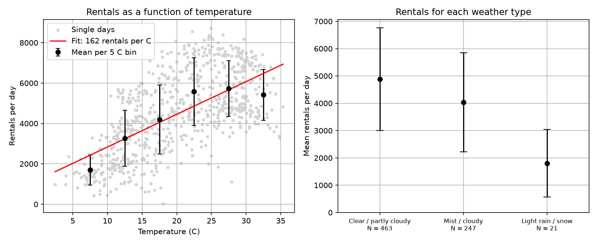

# How Weather and Temperature Change Daily Bike Rentals

Course project for MAT2007 *Introduction to programming* (Maastricht University).

## Research question

How do weather and temperature change the number of bikes rented per day?

Bike sharing is a cheap, low-emission way to get around a city, and cycling is
sensitive to the weather. Knowing how much demand drops on cold or rainy days helps a
bike-share company plan how many bikes to put out and when to do maintenance.

## Data

- **Source:** UCI Machine Learning Repository, *Bike Sharing Dataset* (daily data),
  Hadi Fanaee-T (2013), licence CC BY 4.0.
- **What it is:** Capital Bikeshare in Washington, DC, USA, 731 days
  (1 Jan 2011 – 31 Dec 2012).
- **Columns used:** `yr` (0 = 2011, 1 = 2012), `weathersit`
  (1 clear, 2 mist/cloudy, 3 light rain/snow), `temp` (stored divided by 41, so the
  script multiplies by 41 to get °C) and `cnt` (total rentals that day).
- **File:** `data.py.csv` (must be in the same folder as the script; keep the name in
  lower case so it also works on Linux/Windows).

## Method (only course tools: numpy and matplotlib)

| Part | What it does |
|------|--------------|
| 1 | Mean rentals per weather type, with the standard deviation (SD) as uncertainty |
| 2 | Difference between clear and rainy days, uncertainty = sqrt(SD₁² + SD₂²) |
| 3 | Mean rentals per 5 °C temperature bin (bins with fewer than 5 days skipped), straight-line fit (`np.polyfit`) and Pearson correlation (`np.corrcoef`) |
| 4 | Uncertainty on the slope with sub-sampling: shuffle the days (seed 42), split into 10 groups, fit the slope in each, report mean ± SD of the 10 slopes |
| 5 | Check by year, because rentals grew a lot from 2011 to 2012 |
| 6 | Plot of the results, saved as `bike_results.png` |

The uncertainty is always the **standard deviation**. It describes the day-to-day
spread, and it does not shrink when more days are added.

## How to run

```
pip install numpy matplotlib
python analysis.py
```

Put `data.py.csv` in the same folder. The script prints the results of each part and
saves `bike_results.png`.

## Results

| Weather | Days | Mean rentals per day (± SD) |
|---------|------|------------------------------|
| Clear / partly cloudy | 463 | 4877 ± 1880 |
| Mist / cloudy | 247 | 4036 ± 1809 |
| Light rain / snow | 21 | 1803 ± 1240 |

- Clear minus rain/snow: **3074 ± 2252** rentals per day (about 63 % fewer on rainy days).
- Temperature: slope of **160 ± 24** extra rentals per day for every +1 °C
  (sub-sampling), correlation **r = 0.63**.
- Rentals rise from about 1700 per day at 5–10 °C to about 5700 at 25–30 °C, and then
  stay flat or drop slightly above 30 °C.



## Limitations

- **Association, not causation.** Temperature and rentals move together, but season,
  holidays and weekdays also play a role.
- **Growth between years.** The mean rose from 3406 ± 1379 (2011) to 5600 ± 1789
  (2012). Within each year the pattern is the same (slope 137 in 2011, 177 in 2012;
  r = 0.77 and 0.71), so the year effect does not explain the result away.
- **Not a straight line.** The straight fit overshoots above about 25 °C, where the
  curve flattens.
- **Few rainy days.** Only 21 days with rain/snow (6 in 2012), so the rain result is
  less certain than the temperature result.
- **One city.** The results describe Washington, DC and may not hold elsewhere.

## Files

- `analysis.py` – the analysis script (parts 1–6)
- `data.py.csv` – the dataset (Bike Sharing daily data, used as downloaded; no cleaning needed)
- `bike_results.png` – output figure
- `report.pdf` – the short report (2 pages plus cover); `report.tex` is its LaTeX source
- `README.md` – this file

## Reference

Fanaee-T, H. (2013). *Bike Sharing* [Dataset]. UCI Machine Learning Repository.
https://archive.ics.uci.edu/dataset/275/bike+sharing+dataset
